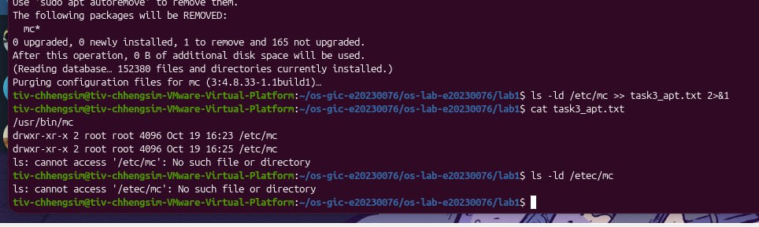
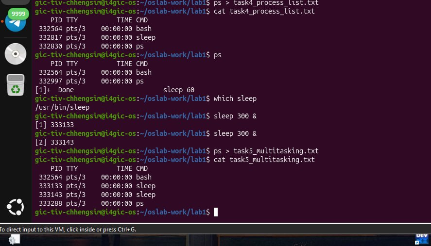
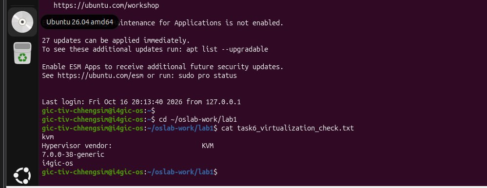

# OS Lab 1 Submission
Student Name: TIV Chhengsim
Student ID: e20230076
Ubuntu username on the server: gic-tiv-chhengsim
My values (oslab values lab1): file1 = stone, file2 = panda, count = 2
## Task 1: Operating System Identification
I used uname -a and lsb_release -a to identify the operating system and kernel of the course server.
The server runs Ubuntu 26.04.1 LTS, and its Linux kernel release is 7.0.0-38-generic.
I learned that the kernel is the core of the operating system responsible for managing hardware and system resources, while Ubuntu is a Linux distribution that includes the kernel and other software.
## Task 2: Essential Linux File and Directory Commands
In this task, I practiced creating directories and files using mkdir and touch. I used echo to write text into files, cp to copy files, mv to rename files, and rm to delete unnecessary copies.
My personal filenames were stone.txt and panda.txt. After renaming the second file and removing the extra files, the final ls command displayed:
panda_renamed.txt
stone.txt
This task helped me understand how to manage files and directories using Linux commands.
## Task 3: Package Management Using APT
I used APT on my personal Ubuntu virtual machine to install, remove, and purge the mc (Midnight Commander) package.
After installation, the program was available at /usr/bin/mc, and the configuration directory /etc/mc existed.
After running sudo apt-get remove mc -y, the program was uninstalled, but /etc/mc still existed.
After running sudo apt-get purge mc -y, the configuration directory was removed. The command ls -ld /etc/mc displayed No such file or directory.
I learned that remove uninstalls a package while generally preserving its system configuration, whereas purge also removes the package's configuration files.

## Task 4: Programs vs Processes
I first used which sleep to locate the sleep program at /usr/bin/sleep.
Then I executed sleep 60 & to run the program in the background and used ps to display the running processes. The output showed the sleep process with its own process ID (PID).
After 60 seconds, the process finished and disappeared from the process list. However, which sleep still displayed the program's location.
This demonstrated that a program is a set of instructions stored on disk, while a process is a running instance of a program.
## Task 5: Multitasking
I started two background processes by running sleep 300 & twice.
When I executed ps, the output showed two sleep processes with different PIDs: 333133 and 333143.
This demonstrated that Ubuntu can manage multiple processes concurrently.
However, this experiment does not prove that both processes were executing CPU instructions simultaneously or explain how CPU time was shared. The sleep command mainly waits without actively using the processor.

## Task 6: Virtualization and Hypervisor Detection
I used systemd-detect-virt, lscpu, uname -r, and hostname to examine the course server.
The results were:
Virtualization type: kvm
Hypervisor vendor: KVM
Kernel release: 7.0.0-38-generic
Hostname: i4gic-os
These results confirm that the course server runs inside a virtual machine using KVM virtualization rather than directly on physical hardware.

## My Prediction: Confirmed or Corrected
Prediction 1 — Number of sleep processes
My prediction was one sleep process. After starting two copies and running ps, I observed two separate sleep processes. Therefore, my prediction was corrected.
Prediction 2 — Whether the sleep program remains on disk
I predicted that the program would no longer exist after the processes finished. However, which sleep still returned /usr/bin/sleep. Therefore, my prediction was corrected.
Prediction 3 — Whether removing a package deletes its configuration
I predicted that apt-get remove would not delete the configuration folder. After removing mc, the directory /etc/mc still existed. Therefore, my prediction was confirmed.
